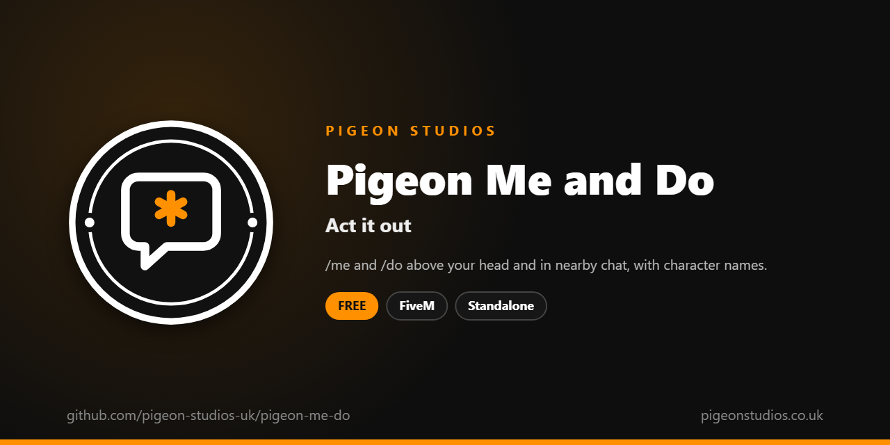

<div align="center">
  

  <h1>Pigeon Me and Do</h1>

  <p><strong>/me and /do above your head and in nearby chat, with character names on Qbox, QBCore and ESX.</strong></p>

  <p>
    <a href="https://github.com/pigeon-studios-uk/pigeon-me-do/releases/latest"></a>
    <a href="LICENSE.md"></a>
    <a href="https://discord.gg/2NFVWEUmDF"></a>
    
  </p>

  <p>
    <a href="https://github.com/pigeon-studios-uk/pigeon-me-do/releases/latest"><strong>Download</strong></a> ·
    <a href="#installation">Install</a> ·
    <a href="#configuration">Configure</a> ·
    <a href="CHANGELOG.md">Changelog</a> ·
    <a href="https://discord.gg/2NFVWEUmDF">Support</a>
  </p>
</div>

---

## Contents

- [Overview](#overview)
- [Features](#features)
- [Requirements](#requirements)
- [Installation](#installation)
- [Updating](#updating)
- [Configuration](#configuration)
- [Localisation](#localisation)
- [Commands and exports](#commands-and-exports)
- [How it works](#how-it-works)
- [Update checker](#update-checker)
- [Performance](#performance)
- [Security](#security)
- [Troubleshooting](#troubleshooting)
- [FAQ](#faq)
- [Support](#support)
- [Contributing](#contributing)
- [Licence](#licence)
- [Credits](#credits)

## Overview

Pigeon Me and Do is a free resource by [Pigeon Studios](https://pigeonstudios.co.uk) for the two commands every roleplay server uses. `/me` says what your character does ("pulls out a notepad"), and `/do` says what's happening around them ("The notepad is full of phone numbers"). They let players act out what animations can't show.

The text floats above the character's head for a few seconds, so people nearby can see who's doing what, and goes in the chat of everyone close enough, with the character's name on Qbox, QBCore and ESX. The server tidies every message, so nobody can paint the screen with colour codes or send a wall of text.

## Features

- **Above the head.** Up to three lines float over the character for 7 seconds, in two colours.
- **Nearby chat.** Players within 20 metres get it in chat, with the character's name.
- **Character names.** On Qbox, QBCore and ESX, and the player's name anywhere else.
- **Tidied by the server.** No GTA colour codes, no HTML, one line, 120 characters at most, one a second.
- **Your look.** Colours, distance, time and command names in the config.
- **23 languages.** Follows ox_lib's language, or set your own.
- **Standalone.** No framework or other resources needed.

## Requirements

| Requirement | Version | Notes |
|---|---|---|
| FXServer | A [recommended artifact](https://runtime.fivem.net/artifacts/) | |
| [ox_lib](https://github.com/communityox/ox_lib) | Optional | Used for the language if it's running |

**Frameworks:** none needed. It works the same on standalone and vMenu servers, ESX Legacy, QBCore, Qbox and ox_core.

## Installation

1. **Download** `pigeon-me-do.zip` from the [latest release](https://github.com/pigeon-studios-uk/pigeon-me-do/releases/latest). Don't use the green **Code** button; release zips are the tested builds.
2. **Extract** it into your server's `resources` folder. The folder must be called `pigeon-me-do`.
3. **Start it** by adding this to `server.cfg`, after ox_lib if you use it:

   ```cfg
   ensure pigeon-me-do
   ```

4. **Configure** it in `configuration/config.lua` if you want to change anything. The defaults work as they are.
5. **Restart** your server. The console shows one line from the update checker:

   ```text
   [Pigeon Studios] Pigeon Me and Do v1.0.0 is up to date.
   ```

## Updating

1. Read the [changelog](CHANGELOG.md) for every version between yours and the latest, especially any **Upgrade notes**.
2. Back up your `configuration/` and `locales/` folders.
3. Replace the `pigeon-me-do` folder with the new release.
4. Copy your changed settings into the new `configuration/config.lua`. Don't copy the old file over the new one; new versions can add settings.
5. Restart the resource.

## Configuration

All settings are in `configuration/config.lua`, each explained by a comment next to it.

| Setting | Default | What it does |
|---|---|---|
| `Config.Locale` | `'auto'` | The language. `'auto'` follows ox_lib's; or a code such as `'de'` (see [Localisation](#localisation)) |
| `Config.Commands` | `me, do` | The command names |
| `Config.Distance` | `20.0` | Metres away that players see the text and get the chat message |
| `Config.Seconds` | `7` | Seconds the text stays above the head |
| `Config.MaxLength` | `120` | The longest text, in characters |
| `Config.Chat` | `true` | Also put it in nearby players' chat |
| `Config.Colours` | `purple, orange` | Colours for `/me` and `/do`, as `{ red, green, blue }` |
| `Config.Names` | `'character'` | `'character'` for character names on Qbox, QBCore and ESX, or `'player'` for FiveM names |

## Localisation

Pigeon Me and Do comes in 23 languages: `en` English, `cs` Czech, `da` Danish, `de` German, `es` Spanish, `et` Estonian, `fi` Finnish, `fr` French, `hr` Croatian, `hu` Hungarian, `id` Indonesian, `it` Italian, `nl` Dutch, `no` Norwegian, `pl` Polish, `pt` Portuguese, `pt-br` Brazilian Portuguese, `ro` Romanian, `sl` Slovenian, `sv` Swedish, `tr` Turkish, `zh-cn` Simplified Chinese and `zh-tw` Traditional Chinese. They're the languages ox_lib ships, so your server may already have one set.

With `Config.Locale = 'auto'` (the default), it uses ox_lib's language, so one line in `server.cfg` sets it for this and every other resource that follows ox_lib:

```cfg
setr ox:locale "de"
```

Use `setr`, not `set`, so players' games get it too. Without it, or for a language that isn't in `locales/`, the text is English. To choose a language for this resource only, set `Config.Locale` to its code, such as `'fr'` or `'pt-br'`.

The `/me` and `/do` formats (`* {text} *` and so on) are in the locale files too, so you can change how they look. Chinese text can show as blank in GTA's own text, such as its notifications, because GTA only loads its Chinese font when the game itself is set to Chinese. ox_lib's notifications show every language.

Every file was checked for missing text and placeholders, but not every translation has been read by a native speaker yet. If something reads wrong, please send a fix; see [Contributing](#contributing). To add a language, copy `locales/en.lua` to a new file named with the language's code (such as `ja.lua`), change `Locales.en` at the top to match (`Locales.ja`), and translate the text in quotes.

## Commands and exports

### Commands

| Command | Who | What it does |
|---|---|---|
| `/me <text>` | Everyone | An action: `/me pulls out a notepad` shows `* pulls out a notepad *` |
| `/do <text>` | Everyone | A description: `/do The notepad is full of numbers` |

In chat, nearby players see:

```text
* Jane Doe pulls out a notepad
* The notepad is full of numbers ((Jane Doe))
```

The command names change with `Config.Commands`. If another resource already has `/me` or `/do`, turn one of them off.

## How it works

When a player uses `/me` or `/do`, their game sends the text to the server. The server checks they aren't sending more than one a second, tidies the text (it removes GTA's colour codes, HTML and new lines, and cuts it to `Config.MaxLength` characters), looks up the character's name, and sends it to every player.

Each player's game shows it only if the sender is within `Config.Distance`: above the sender's head, for `Config.Seconds`, with the newest line at the bottom and three at most, and in chat with `Config.Chat`. The text follows the character as they move, and isn't drawn once they move out of range.

Character names come from Qbox, QBCore or ESX when one is running (first and last name), and the player's FiveM name otherwise. Chat messages use the standard `chat` resource that comes with FiveM.

## Update checker

When it starts, Pigeon Me and Do checks our public [version registry](https://github.com/pigeon-studios-uk/pigeon-versions) once and prints one line in the server console saying whether it's up to date. If there's an update, it shows what's new and where to get it. The check is a single request to GitHub and sends nothing about your server or players.

Control it for every Pigeon Studios resource at once in `server.cfg`:

```cfg
set pigeon_update_check "on"      # default: one line per resource
set pigeon_update_check "quiet"   # only when there's an update or a problem
set pigeon_update_check "off"     # never check
```

## Performance

Nothing runs until someone uses a command. While text is showing, each game draws it every frame for the senders near it, which costs next to nothing; the loop stops when the last line goes. Each message is one small event through the server.

## Security

- The server tidies every message: no GTA colour or formatting codes, no HTML, one line and `Config.MaxLength` characters at most. Players can't use it to put images, links or a screen of text in other players' chat.
- It's rate-limited to one message a second for each player.
- Names come from the server, so players can't send messages as someone else.
- The only network request is the update check at start-up, from the server to GitHub. It sends nothing about your server or players.

Found a problem? Please don't open a public issue. Use the **Report a vulnerability** button in this repository's **Security** tab, or follow our [Security Policy](https://github.com/pigeon-studios-uk/.github/blob/main/SECURITY.md).

## Troubleshooting

**Nothing shows in chat.**
Check FiveM's `chat` resource is running, and that `Config.Chat` is `true`. Text above heads works without it.

**Messages show twice.**
Another resource also has `/me` or `/do`. Turn its commands off, or change `Config.Commands`.

**The wrong name shows.**
Character names need Qbox, QBCore or ESX to be started before this resource. Without them, or with `Config.Names = 'player'`, it shows the FiveM name.

**The text is in the wrong language.**
Check `setr ox:locale` in `server.cfg` (with `setr`, not `set`), or set `Config.Locale` to the language's code.

**The console says "isn't in the version registry" or "couldn't check for updates".**
Your server couldn't reach GitHub, or the check is blocked by a firewall. The resource works normally either way. Turn the check off with `set pigeon_update_check "off"`.

## FAQ

**Is it really free?**
Yes. Use it on as many servers as you like, including ones that take donations. You just can't reupload, resell or bundle it. See [Licence](#licence).

**Does it work on standalone and vMenu servers?**
Yes. It needs no framework at all, and works alongside vMenu.

**Can staff see every /me?**
Only within `Config.Distance`, like everyone else. Use a logging resource for a full record.

**Does it work with voice chat?**
Yes. They're separate; `/me` and `/do` are for what voice can't show.

**Can I add /ooc or /twt?**
Not with this resource. It does `/me` and `/do` and nothing else, to stay small.

## Support

Read [Troubleshooting](#troubleshooting) first, then ask in the support channels of our [Discord](https://discord.gg/2NFVWEUmDF). Please include your Pigeon Me and Do version, FXServer artifact and any errors from the console (F8 in game). See [Getting help](https://github.com/pigeon-studios-uk/.github/blob/main/SUPPORT.md).

Found a bug? Open a [bug report](https://github.com/pigeon-studios-uk/pigeon-me-do/issues/new/choose).

## Contributing

Fixes, improvements and translations are welcome. Please read the [contributing guide](https://github.com/pigeon-studios-uk/.github/blob/main/CONTRIBUTING.md) first, and open a feature request before working on anything big.

## Licence

Pigeon Me and Do is free to use under the **[Pigeon Studios Free Licence](LICENSE.md)**.

- ✅ Use it on any number of servers, including monetised ones
- ✅ Change it for your own servers
- ✅ Show it in videos and streams
- ❌ Don't reupload, share or mirror the files; link to this repository instead
- ❌ Don't sell it, bundle it in packs, or put it behind escrow
- ❌ Don't remove the credits

This summary isn't the licence; [LICENSE.md](LICENSE.md) is. Third-party components are listed in [NOTICE.md](NOTICE.md).

## Credits

Made by [Pigeon Studios](https://pigeonstudios.co.uk). Thanks to everyone who has contributed fixes and translations; see the [changelog](CHANGELOG.md).

<sub>Not affiliated with or endorsed by Rockstar Games, Take-Two Interactive or Cfx.re.</sub>
